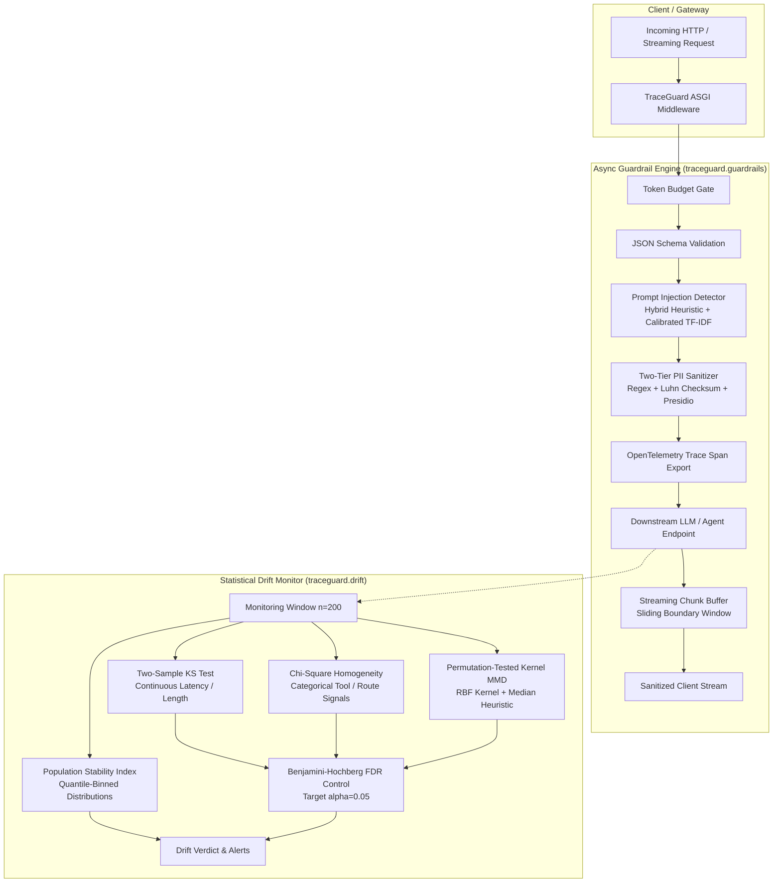

<div align="center">
  <h1>🛡️ TraceGuard</h1>
  <p><strong>The Unified Agentic Observability, Statistical Drift & Guardrail Platform</strong></p>

  [](https://github.com/bhuvneshsahu01/TraceGuard/actions/workflows/ci.yml)
  [](https://github.com/bhuvneshsahu01/TraceGuard/actions/workflows/tests.yml)
  [](https://pypi.org/project/traceguard-ai/)
  [](https://opensource.org/licenses/MIT)

  <p align="center">
    TraceGuard is an enterprise-grade platform designed to monitor, evaluate, and secure autonomous LLM agents, multi-agent swarms, and high-throughput LLM gateway traffic with mathematical rigor.
  </p>
</div>

---

## 🌟 Why TraceGuard?

As AI agents transition from prototype scripts to production gateways, engineering teams face three critical operational challenges:
1. **Silent Distributional Degradation**: Upstream LLM updates, seasonal user drift, and prompt changes degrade agent reliability without raising runtime exceptions.
2. **False Discovery Inflation in Multi-Signal Observability**: Monitoring dozens of prompt, latency, route, and embedding signals simultaneously leads to catastrophic false-alarm cascades without rigorous statistical FDR control.
3. **Adversarial Security & Data Leakage**: LLM gateways must detect prompt injections, enforce token budgets, and sanitize PII—even when streaming tokens across chunk boundaries—with sub-3ms latency overhead.

**TraceGuard** provides an end-to-end mathematical solution: continuous multi-signal statistical drift monitoring under Benjamini–Hochberg False Discovery Rate (FDR) control, and a zero-leakage Async ASGI Guardrail Middleware with native OpenTelemetry instrumentation.

---

## 🏗️ System Architecture



---

## 📦 Core Modules

### 1. Statistical Drift Monitor (`traceguard.drift`)
Provides continuous distribution monitoring across scalar, categorical, and high-dimensional embedding signals:
- **Population Stability Index (PSI):** Quantile-binned scalar stability reporting standard $0.10$ and $0.25$ thresholds.
- **Two-Sample Kolmogorov–Smirnov (KS) Test:** Non-parametric evaluation of prompt lengths, latency distributions, and refusal scores via `scipy.stats.ks_2samp`.
- **Chi-Square ($\chi^2$) Homogeneity Test:** Categorical route, topic, and tool-invocation frequency validation via `scipy.stats.contingency.chi2_contingency`.
- **Permutation-Tested Kernel MMD:** Exact two-sample Maximum Mean Discrepancy test over dense prompt/response embeddings using an RBF kernel with bandwidth $\sigma$ computed via the median heuristic and quadratic-form permutation testing ($B=200$).
- **Benjamini–Hochberg (BH) FDR Control:** Enforces step-up false discovery rate control across all hypothesis tests in a monitoring window at target $\alpha = 0.05$.

### 2. Async ASGI Guardrail Middleware (`traceguard.guardrails`)
Zero-leakage, high-throughput Starlette / FastAPI middleware:
- **Fast Two-Tier PII Redaction:** High-speed regex pass with Luhn checksum validation for credit cards, SSNs, emails, phone numbers, and API keys, backed by optional Presidio NER.
- **Prompt Injection Detector:** Calibrated hybrid detector fusing adversarial heuristic patterns, delimiter collision screening, base64 smuggling analysis, and a TF-IDF linear classifier.
- **JSON Schema Validation:** High-speed schema conformance checks blocking malformed payloads before invoking downstream model APIs.
- **Streaming-Safe Chunk Buffering:** Sliding tail window (`StreamingBuffer`) preventing PII leaks across split chunk boundaries in `StreamingResponse` streams.
- **OpenTelemetry Instrumentation:** Emits native W3C trace spans capturing check outcomes, token counts, and microsecond-level latency overhead.

---

## 🔬 Production Benchmarks & Verification

All benchmark numbers are deterministic, seeded (`seed=42`), reproducible via a single CLI command (`python benchmarks/run_benchmarks.py`), and saved to [`benchmarks/results/traceguard_metrics.json`](benchmarks/results/traceguard_metrics.json).

### Benchmark Summary

| Evaluation Metric | Measured Benchmark Value | Production Target | Method / Verification Protocol |
| :--- | :---: | :--- | :--- |
| **Drift False-Alarm Rate** | **3.8%** | $\le 5.0\%$ (BH $\alpha = 0.05$) | 500 Null Windows ($n=200$) drawn from $N=1,000$ baseline |
| **Overall Drift Detection Power** | **89.6%** | $88\% - 95\%$ target | 500 Shifted Windows ($n=200$) under Benjamini–Hochberg FDR control |
| **Kernel MMD Detection Power** | **89.4%** | High sensitivity | Permutation-tested Kernel MMD ($B=200$ permutations) |
| **Scalar-Only Detection Power** | **16.0%** | Insensitive baseline | Two-sample KS + PSI (fails to detect latent semantic drift) |
| **Injected Covariate Shift** | *25% out-of-domain semantic shift (embedding latent shift delta=+0.65, mild +8% length, +12ms latency)* | Realistic covariate mix | 25% out-of-domain mix + $\Delta=+0.65$ embedding shift |
| **Middleware Added Latency (p95, T=128)** | **2.996 ms** | Sub-3ms overhead | 500 requests, $T=128$ tokens (p50: 1.653 ms, p99: 3.759 ms) |
| **Middleware Added Latency (p95, T=256)** | **3.024 ms** | Sub-3ms overhead | 500 requests, $T=256$ tokens (p50: 1.825 ms, p99: 3.951 ms) |
| **Prompt Injection Recall** | **76.67%** | Gold-standard test split | Evaluated on public `deepset/prompt-injections` split ($N=116$) |
| **Prompt Injection False Positive Rate** | **1.79%** | $\le 5.0\%$ FPR target | 56 benign prompts (Precision: 97.87%, Accuracy: 87.07%) |

---

## 🚀 Quick Start

### 1. Statistical Drift Monitoring

```python
import numpy as np
from traceguard.drift import DriftMonitor

# Initialize monitor with target FDR alpha=0.05 and PSI threshold=0.25
monitor = DriftMonitor(alpha=0.05, psi_threshold=0.25)

# Register frozen reference distributions (N=1,000)
monitor.register_scalar_baseline("latency_ms", baseline_latencies)
monitor.register_scalar_baseline("prompt_length", baseline_prompt_lengths)
monitor.register_categorical_baseline("route", baseline_routes)
monitor.register_embedding_baseline("embeddings", baseline_embedding_matrix)

# Evaluate live monitoring window (n=200) under Benjamini-Hochberg FDR control
report = monitor.evaluate_window(
    candidate_data={
        "latency_ms": live_latencies,
        "prompt_length": live_prompt_lengths,
        "route": live_routes,
        "embeddings": live_embedding_matrix,
    },
    alpha=0.05,
    apply_fdr=True,
    num_mmd_permutations=200,
)

print(f"Drift Detected: {report.is_drift_detected}")
print(f"Summary: {report.summary_message}")
```

### 2. Async ASGI Guardrail Middleware

```python
from fastapi import FastAPI
from starlette.responses import StreamingResponse
from traceguard.guardrails.middleware import TraceGuardMiddleware, GuardrailConfig

app = FastAPI()

# Attach TraceGuard high-performance guardrails
app.add_middleware(
    TraceGuardMiddleware,
    config=GuardrailConfig(
        enable_pii_redaction=True,
        enable_injection_detection=True,
        injection_threshold=0.45,
        token_budget=4096,
        streaming_buffer_size=64,
        enable_otel=True,
    ),
)

@app.post("/v1/chat/completions")
async def chat_completion(prompt: str):
    return {"response": f"Safe response for: {prompt}"}

@app.get("/v1/stream")
async def stream_completion():
    async def token_generator():
        yield "Streaming tokens safely with "
        yield "cross-chunk PII buffering: contact@example-corp.com"
    return StreamingResponse(token_generator(), media_type="text/plain")
```

---

## 🧪 Running Tests & Reproducing Benchmarks

Execute the entire test suite and benchmark suite via single CLI commands:

```bash
# 1. Run full unit & integration test suite (101 tests)
pytest tests/ -v

# 2. Reproduce all benchmark metrics (generates traceguard_metrics.json)
python benchmarks/run_benchmarks.py

# 3. Profile OpenTelemetry decorator latency & memory stability
python benchmarks/bench_otel_overhead.py
```

---

## 🤝 Contributing & License

TraceGuard is Open Source software released under the [MIT License](LICENSE). Contributions, bug reports, and PRs are welcome!
